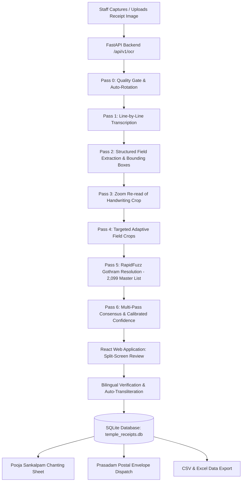

# System Architecture: Sri Trikoteswara Swamy Temple Receipt OCR System

## 1. System Overview

The **Trikuta Temple Receipt OCR & Pooja Management System** is a mobile-first, bilingual (Telugu + English) web application designed for temple administrative staff and priests at **Sri Trikoteswara Swamy Vari Devasthanam, Kotappakonda**.

The system automates the digitization, verification, pooja sankalpam scheduling, and prasadam delivery tracking for handwritten temple receipts.

---

## 2. Technology Stack

| Layer | Component | Technology | Rationale |
| :--- | :--- | :--- | :--- |
| **Frontend** | Framework | React 18 + Vite 6 + TypeScript | Instant HMR, type-safe development, sub-second builds |
| **Frontend** | Styling | Tailwind CSS 3 | Mobile-first responsive styling, utility-first layout |
| **Frontend** | Typography | Noto Sans + Noto Sans Telugu | Authentic bilingual typography with high contrast for priests |
| **Frontend** | Icons | Lucide React | Modern, lightweight, accessible iconography |
| **Backend** | Framework | FastAPI + Uvicorn (Python 3.12) | High-performance async ASGI framework with OpenAPI docs |
| **Backend** | AI & Vision | Google Gemini Interactions SDK | `gemini-3.5-flash-lite` primary model with fallback routing |
| **Database** | ORM & Engine | SQLAlchemy 2.0 + SQLite (WAL mode) | Robust ACID relational store with foreign-key integrity |
| **Migrations**| Schema Versioning | Alembic | Reproducible, version-controlled schema migrations |
| **Matching** | Fuzzy Resolution | RapidFuzz | C++ accelerated Levenshtein and phonetic matching |
| **Image Ops** | Preprocessing | Pillow (PIL) + OpenCV | EXIF rotation correction, Laplacian blur variance detection |

---

## 3. Database Schema

The database consists of 8 relational models in `backend/app/models/`:

1. **`gothram_master`**: 2,099 clean, unique Gothrams seeded from the temple registry, with English transliteration, Telugu script, and phonetic normalization keys.
2. **`receipts`**: Core receipt entity containing receipt numbers, dates, pooja periods, amounts, resolved Gothram IDs, address, status (`PENDING_VERIFICATION`, `CONFIRMED`, `INCOMPLETE`), image file paths, model metadata, latency, and cost.
3. **`receipt_persons`**: Devotee family members associated with receipts, preserving position, given name, surname, and verification status.
4. **`receipt_phones`**: Devotee contact phone numbers with primary flags and 10-digit validation status.
5. **`prasadam_dispatches`**: Delivery queue tracking packing, dispatch date, carrier, and tracking numbers.
6. **`corrections`**: Audit records of human corrections made to AI-extracted values.
7. **`audit_logs`**: Administrative audit trail tracking all user operations.
8. **`users`**: Administrative and staff credentials with bcrypt password hashing and JWT sessions.

---

## 4. Multi-Pass AI Pipeline Architecture

The OCR pipeline in `backend/pipeline/` executes sequentially across 6 distinct phases:

- **Pass 0 (Preparation & Quality Gate)**:
  - Transposes EXIF orientation.
  - Computes Laplacian edge blur variance ($\sigma^2$), luminance distribution, and resolution.
  - Determines orientation (0°, 90°, 180°, 270°) and applies rotation if necessary.
- **Pass 1 (Transcription)**:
  - Transcribes every printed and handwritten line verbatim from top to bottom.
- **Pass 2 (Structured Extraction)**:
  - Extracts receipt header, pooja dates, amounts, address, phone numbers, and normalized bounding box coordinates for handwriting and specific field lines.
- **Pass 3 (Zoom Handwriting Re-read)**:
  - Crops the handwriting bounding box, upscales to 2,000 pixels, and performs an independent secondary extraction on the isolated handwriting.
- **Pass 4 (Adaptive Targeted Crops)**:
  - Tight crops around the Gothram and phone number lines to eliminate ambiguity in dense handwriting.
- **Pass 5 (Tiered Gothram Resolution)**:
  - Extracts candidate matches from the 2,099 Master Gothram list using RapidFuzz ($TOP\_K=40$).
  - Prompts Gemini to select the exact reference Gothram only when supported by the handwriting strokes; escalates to the full reference list if confidence is marginal.
- **Pass 6 (Consensus & Evidence-Based Calibration)**:
  - Compares findings across passes.
  - Ensures no family members are dropped.
  - Calibrates Green / Amber / Red confidence indicators per field.
  - Calculates exact token usage and API cost.

---

## 5. Security & Data Protection

- **Credentials**: Passwords hashed with bcrypt; JWT tokens signed with HS256.
- **Access Control**: Role-based access control (`ADMIN` vs. `STAFF`).
- **Data Integrity**: Foreign keys enforced via SQLite pragmas (`PRAGMA foreign_keys=ON;`).
- **Input Validation**: Strict Indian mobile (10-digit `^[6-9]\d{9}$`) and postal PIN (`^\d{6}$`) validation.
